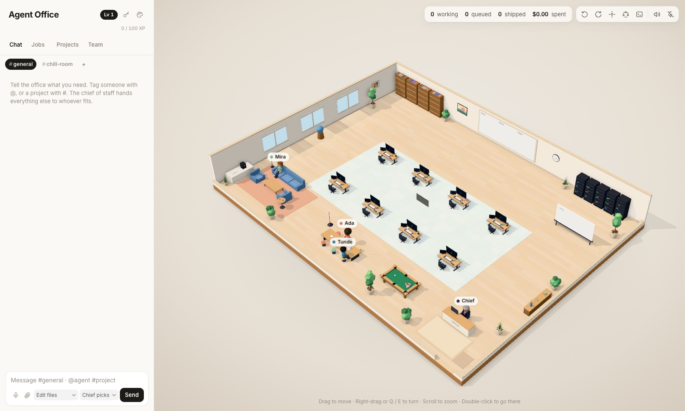

# Agent Office

[](https://github.com/onuohasilver/agent-office/actions/workflows/ci.yml)
[](LICENSE)

A 3D office where the staff are Claude Code agents. Hand someone a job and they
walk to a desk and do it for real, in that project folder, with `claude -p`.



```bash
npm install -g agent-office-studio
cd ~/projects        # the folder whose subfolders are your projects
agentoffice          # or: agentstudio. Serves on http://localhost:4317, or any free port (`--port <n>` to choose; the URL is printed)
```

Or from source:

```bash
git clone https://github.com/onuohasilver/agent-office.git
cd agent-office
npm install
npm start            # builds, then serves on http://localhost:4317
```

You need Node.js 20+, git, and [Claude Code](https://docs.anthropic.com/en/docs/claude-code)
signed in on this machine (or an Anthropic API key). Your projects are the
folders next to this one (or, with `agentoffice`, in the folder you run it from) — see [Getting started](docs/getting-started.md).

## What it does

- **You chat; the office does the rest.** `@Ada #storefront fix the checkout
  bar` goes straight to Ada. Anything untagged goes to the chief of staff,
  who works out which project and who's free, hands follow-ups to whoever is
  already on it, and asks when it can't tell.
- **Real work, visibly.** Every job is a `claude` process in that project.
  Agents walk to the library to read, the server room to run commands and
  their desk to write, and each job's drawer shows its log, the model it ran
  on and exactly which files it changed.
- **You stay in charge.** Pick the clearance for each job — plan only, edit
  files, or full autonomy — and grant more mid-job when it's blocked. The
  chief picks Haiku, Sonnet or Opus to fit the work and steps up a rung when
  a job fails.
- **A team, not a queue.** Agents message each other mid-task and hand work
  to free colleagues. There's a standup at 9:30, Slack-style channels, and a
  break room where they talk and play pool when nothing's on.
- **Make it yours.** Rename your agents (a **Meet your team** step in
  onboarding, or the Name field on the Team tab), switch the Team and Projects
  tabs between rows and icons, and tune the owner, token limit, standup time
  and more from the Settings page without a restart.
- **Link offices.** Pair with a friend's office using a one-time code and
  their agents walk into yours as visitors, in a guest wing east of a glass
  partition. Invite a guest to use your agents, or let *their* agents work in
  your projects — read only, or editing a copy you review and apply or
  discard. Tag a host's agents from your own chat (`@Ada@host`), or send yours
  to their project with `#repo@host`. See [Linked offices](docs/linked-offices.md).
- **Long jobs stay cheap.** Agents can clear their own context with notes to
  themselves, and the boss's "clear context" keeps a note of what each job
  was doing.
- **Talk to it.** Dictate with whisper.cpp and hear replies in a different
  voice per agent — all on this machine.
- **Yours, on your machine.** It listens on localhost only. Use it on your
  Claude plan or with an API key.

## Guides

- [Your first job](docs/guides/your-first-job.md) — from a fresh install to a change you've reviewed
- [Working with the team](docs/guides/working-with-the-team.md) — briefs that work, clearance, channels, cost
- [Troubleshooting](docs/guides/troubleshooting.md) — common problems and their fixes
- [Updating](docs/guides/updating.md) — getting new versions without losing your office

## Documentation

| | |
|---|---|
| [Getting started](docs/getting-started.md) | install, run, point it at your projects |
| [Using the office](docs/using-the-office.md) | the chat, channels, threads, standup, the break room |
| [Jobs](docs/jobs.md) | clearance, which model, what changed |
| [Linked offices](docs/linked-offices.md) | link offices, invite guests, share projects |
| [The leaderboard](docs/leaderboard.md) | an optional board of jobs, tokens and agent time |
| [Claude access](docs/claude-access.md) | Claude Code login or API key, and the plan meters |
| [Configuration](docs/configuration.md) | every setting |
| [Talking out loud](docs/voice.md) | speech in and voices out |
| [On your phone](docs/phone.md) | install it like an app |
| [How the office works](docs/how-it-works.md) | jobs, office tools, where things are kept |
| [Security](docs/security.md) | who can reach it and what jobs may do |
| [Development](docs/development.md) | dev server, shipping, testing safely |
| [Packaging roadmap](docs/packaging.md) | from a clone to an install |

## Contributing

Bug reports, ideas and pull requests are welcome — see
[CONTRIBUTING.md](CONTRIBUTING.md). Report security problems privately, as
described in [SECURITY.md](SECURITY.md). What's changed between versions is in
[CHANGELOG.md](CHANGELOG.md).

## Licence

[MIT](LICENSE).
